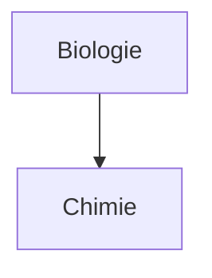
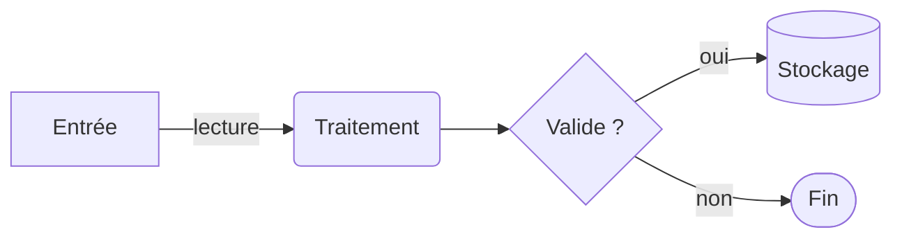

# Aide-mémoire Markdown — Obsidian et GitHub

## Ce que c'est

Une carte de référence de la **syntaxe Markdown** : ce qui se tape, ce qui s'affiche, et où. Comme une fiche de raccourcis clavier posée à côté de l'écran : on la consulte, on ne la lit pas d'un bout à l'autre. Deux outils sont couverts, chacun dans l'ordre de sa documentation officielle : **Obsidian** (l'éditeur pour rédiger) puis **GitHub** (la plateforme où le fichier est lu).

## Ce que ça fait

- Liste chaque construction documentée par Obsidian (*Basic formatting syntax*, *Advanced formatting syntax*, *Callouts*) et par GitHub (*Basic writing and formatting syntax*, *Working with advanced formatting*), avec la syntaxe exacte et son résultat.
- Précise où une construction est reconnue : Obsidian, GitHub, et sur GitHub fichier `.md` ou issue/PR.
- Met les deux outils face à face et donne la table de conversion d'une note Obsidian vers un fichier GitHub.
- Regroupe ce qui est commun : entités HTML et symboles, couleurs réellement disponibles, syntaxe Mermaid, méthode de vérification.

## Ce que ça ne fait pas

- N'apprend pas à **rédiger** une documentation (structure d'un README, conventions d'équipe, relecture) : ce sont d'autres documents du module.
- Ne couvre pas les autres dialectes Markdown (Pandoc, GitLab, MkDocs, Notion, Discord…) ni les extensions ajoutées par un thème ou un module complémentaire Obsidian.
- Ne remplace pas un test de rendu : un doute se lève en affichant le fichier là où il sera lu ([3.6](#36-méthode-de-vérification)).
- Ne fait pas le café — mais sait l'écrire en **gras**, ~~barré~~, ==surligné== ou en schéma : `Café[(tasse)]`.

Sources : Obsidian Help — *Basic formatting syntax*, *Advanced formatting syntax*, *Callouts*, changelog 1.14 ; GitHub Docs — *Basic writing and formatting syntax*, *Working with advanced formatting* (tables, collapsed sections, code blocks, diagrams, mathematical expressions, autolinked references) ; spécification GitHub Flavored Markdown ; spécification CommonMark 0.31.2.

## Sommaire

**Partie 1 — Obsidian**

- [1.1 Paragraphes et retours à la ligne](#11-paragraphes-et-retours-à-la-ligne)
- [1.2 Titres](#12-titres)
- [1.3 Mise en forme du texte](#13-mise-en-forme-du-texte)
- [1.4 Liens](#14-liens)
- [1.5 Images et intégrations](#15-images-et-intégrations)
- [1.6 Citations et encadrés (callouts)](#16-citations-et-encadrés-callouts)
- [1.7 Listes](#17-listes)
- [1.8 Séparateur horizontal](#18-séparateur-horizontal)
- [1.9 Code](#19-code)
- [1.10 Notes de bas de page](#110-notes-de-bas-de-page)
- [1.11 Commentaires](#111-commentaires)
- [1.12 Échapper un caractère](#112-échapper-un-caractère)
- [1.13 Tableaux](#113-tableaux)
- [1.14 Schémas](#114-schémas)
- [1.15 Formules mathématiques](#115-formules-mathématiques)
- [1.16 Propriétés en tête de note](#116-propriétés-en-tête-de-note)

**Partie 2 — GitHub**

- [2.1 Titres](#21-titres)
- [2.2 Mise en forme du texte](#22-mise-en-forme-du-texte)
- [2.3 Citations](#23-citations)
- [2.4 Code](#24-code)
- [2.5 Modèles de couleur](#25-modèles-de-couleur)
- [2.6 Liens](#26-liens)
- [2.7 Retours à la ligne](#27-retours-à-la-ligne)
- [2.8 Images](#28-images)
- [2.9 Listes](#29-listes)
- [2.10 Mentions et références automatiques](#210-mentions-et-références-automatiques)
- [2.11 Emoji](#211-emoji)
- [2.12 Notes de bas de page](#212-notes-de-bas-de-page)
- [2.13 Alertes](#213-alertes)
- [2.14 Contenu caché et échappement](#214-contenu-caché-et-échappement)
- [2.15 Tableaux](#215-tableaux)
- [2.16 Sections repliées](#216-sections-repliées)
- [2.17 Schémas](#217-schémas)
- [2.18 Formules mathématiques](#218-formules-mathématiques)
- [2.19 HTML : ce qui passe, ce qui est filtré](#219-html--ce-qui-passe-ce-qui-est-filtré)

**Partie 3 — Commun aux deux**

- [3.1 Obsidian et GitHub face à face](#31-obsidian-et-github-face-à-face)
- [3.2 Convertir une note Obsidian pour GitHub](#32-convertir-une-note-obsidian-pour-github)
- [3.3 Caractères, entités et symboles](#33-caractères-entités-et-symboles)
- [3.4 Couleurs portables](#34-couleurs-portables)
- [3.5 Mermaid : formes, flèches, styles](#35-mermaid--formes-flèches-styles)
- [3.6 Méthode de vérification](#36-méthode-de-vérification)
- [3.7 Lexique](#37-lexique)

---

## Partie 1 — Obsidian

### 1.1 Paragraphes et retours à la ligne

| Besoin | Syntaxe | Remarque |
|---|---|---|
| Nouveau paragraphe | Une ligne vide entre deux blocs de texte | Un simple saut de ligne ne crée pas de paragraphe |
| Retour à la ligne dans un paragraphe | Deux espaces en fin de ligne, ou <kbd>Maj</kbd> + <kbd>Entrée</kbd> | Les deux espaces sont invisibles dans la source |
| Espaces supplémentaires | `&nbsp;` ou `<br>` | Markdown réduit les espaces consécutifs à un seul |
| Réglage « Strict line breaks » (Options → Éditeur) | Activé : un seul retour joint les lignes, deux espaces donnent `<br>`, deux retours un paragraphe | Rend Obsidian conforme au comportement de GitHub sur un fichier |

### 1.2 Titres

```markdown
# Titre de niveau 1
## Titre de niveau 2
### Titre de niveau 3
#### Niveau 4
##### Niveau 5
###### Niveau 6
```

Un à six `#`, suivis d'un espace. Sans l'espace, la ligne reste du texte.

### 1.3 Mise en forme du texte

| Ce que vous écrivez | Résultat | Remarque |
|---|---|---|
| `**gras**` ou `__gras__` | **gras** | — |
| `*italique*` ou `_italique_` | *italique* | — |
| `~~barré~~` | ~~barré~~ | — |
| `==surligné==` | surligné (fond coloré) | Propre à Obsidian |
| `==🔴texte==` | surligné en rouge | Obsidian 1.14 (septembre 2026) : 🔴 🟠 🟡 🟢 🔵 🟣 juste après le `==` ouvrant ; taper `==` propose les couleurs |
| `**gras et _italique imbriqué_**` | **gras et _italique imbriqué_** | — |
| `***gras italique***` ou `___gras italique___` | ***gras italique*** | — |
| `\*\*pas gras\*\*` | \*\*pas gras\*\* | Barre oblique inverse devant chaque symbole |

### 1.4 Liens

| Besoin | Syntaxe | Remarque |
|---|---|---|
| Lien interne vers une note | `[[Nom de la note]]` | Nom sans chemin ni `.md` ; la note est trouvée dans tout le coffre |
| Lien interne, texte affiché différent | `[[Nom de la note\|texte affiché]]` | — |
| Lien vers un titre d'une note | `[[Nom de la note#Titre de section]]` | Le texte exact du titre |
| Lien interne en syntaxe Markdown | `[texte](Nom%20de%20la%20note.md)` | Espaces écrits `%20` |
| Lien externe | `[Obsidian Help](https://help.obsidian.md)` | — |
| Lien vers une note d'un autre coffre | `[Note](obsidian://open?vault=Coffre&file=Note.md)` | Adresse propre à l'application |
| Adresse contenant des espaces | `[Note](<obsidian://open?vault=Coffre&file=Ma Note.md>)` | Chevrons autour de l'adresse, ou `%20` |

### 1.5 Images et intégrations

| Besoin | Syntaxe | Remarque |
|---|---|---|
| Image externe | `` | — |
| Image externe redimensionnée | `` · `` | Largeur × hauteur en pixels ; largeur seule : proportions conservées |
| Image du coffre | `![[image.png]]` · `![[image.png\|300]]` | « Intégration » (embed) d'un fichier du coffre |
| Note du coffre | `![[Nom de la note]]` · `![[Nom de la note#Titre]]` | Le contenu de la note est affiché dans la note courante |

### 1.6 Citations et encadrés (callouts)

```markdown
> Texte de la citation,
> sur plusieurs lignes.
> \- Auteur, année
```

Chaque ligne commence par `>` ; le tiret d'attribution est échappé pour ne pas devenir une puce.

Un **encadré** (callout) est une citation dont la première ligne contient un type entre crochets :

```markdown
> [!info]
> Le corps de l'encadré, en Markdown.
```

| Type | Alias | Couleur | Icône | Usage habituel |
|---|---|---|---|---|
| `note` | — | Bleu | Crayon | Remarque (type par défaut) |
| `abstract` | `summary`, `tldr` | Cyan | Presse-papiers | Résumé |
| `info` | — | Bleu | ⓘ | Information |
| `todo` | — | Bleu | Cercle coché | À faire |
| `tip` | `hint`, `important` | Cyan | Flamme | Astuce |
| `success` | `check`, `done` | Vert | Coche | Réussite |
| `question` | `help`, `faq` | Orange | Point d'interrogation | Question |
| `warning` | `caution`, `attention` | Orange | Triangle | Avertissement |
| `failure` | `fail`, `missing` | Rouge | Croix | Échec, manque |
| `danger` | `error` | Rouge | Éclair | Danger, erreur |
| `bug` | — | Rouge | Insecte | Anomalie |
| `example` | — | Violet | Liste | Exemple |
| `quote` | `cite` | Gris | Guillemets | Citation |

Règles (documentation Obsidian) : le type est **insensible à la casse** ; un type inconnu est affiché comme `note` ; un alias donne exactement le même rendu que son type. Couleurs et icônes sont celles du thème par défaut.

| Variante | Syntaxe |
|---|---|
| Titre personnalisé | `> [!tip] Mon titre` |
| Encadré sans corps | `> [!warning] Le titre seul suffit` |
| Replié par défaut | `> [!faq]- Question` puis le corps : cliquer pour déplier |
| Déplié par défaut, repliable | `> [!faq]+ Question` |
| Imbriqué | `> [!note] Niveau 1` puis `> > [!example] Niveau 2` : un `>` de plus par niveau |
| Type personnalisé | Feuille de style : `.callout[data-callout="mon-type"] { --callout-color: …; --callout-icon: …; }` |

### 1.7 Listes

| Besoin | Syntaxe | Remarque |
|---|---|---|
| Puces | `- élément`, `* élément` ou `+ élément` | — |
| Numérotée | `1. élément` ou `1) élément` | — |
| Retour à la ligne dans un élément, sans changer la numérotation | <kbd>Maj</kbd> + <kbd>Entrée</kbd> | — |
| Tâche à faire | `- [ ] texte` | — |
| Tâche faite | `- [x] texte` | **Tout caractère** entre les crochets marque la tâche faite : `[?]`, `[-]`, `[/]` |
| Imbrication | Indenter l'élément (espaces ou <kbd>Tab</kbd>) ; <kbd>Maj</kbd> + <kbd>Tab</kbd> pour remonter | Les types se mélangent librement (puce sous numéro, etc.) |

```markdown
1. Premier élément
2. Deuxième élément
   1. Sous-élément numéroté
   - Sous-élément à puce
- [x] Tâche terminée
- [ ] Tâche en cours
```

### 1.8 Séparateur horizontal

Trois caractères ou plus, seuls sur leur ligne : `***`, `---` ou `___`. Les espaces entre les symboles sont acceptés (`* * *`, `- - -`). Sous une ligne de texte sans ligne vide, `---` transforme ce texte en titre de niveau 2.

### 1.9 Code

| Besoin | Syntaxe | Remarque |
|---|---|---|
| Code dans la phrase | `` `texte` `` | — |
| Accent grave dans le code | ``` ``code avec ` dedans`` ``` | Deux accents graves de chaque côté |
| Bloc de code | Trois accents graves (ou trois tildes `~~~`) sur la ligne du dessus et du dessous | — |
| Coloration | ```` ```js ```` : le nom du langage après les accents ouvrants | `bash`, `python`, `rust`, `json`, `yaml`, `text`… |
| Bloc indenté | Quatre espaces ou une tabulation en début de ligne | Sans coloration |
| Bloc dans un bloc | Barrière extérieure plus longue que l'intérieure : quatre accents graves autour d'un bloc à trois | — |

### 1.10 Notes de bas de page

```markdown
Une phrase avec une note[^1] et une note nommée[^source].
Une note en ligne^[texte de la note, directement ici].

[^1]: Texte de la première note.
[^source]: Texte de la note nommée.
    Suite sur une deuxième ligne, indentée de deux espaces au moins.
```

La note en ligne `^[…]` n'est affichée qu'en **mode lecture**, pas en aperçu en direct.

### 1.11 Commentaires

```markdown
Texte visible %% commentaire invisible dans la même ligne %% suite visible.

%%
Bloc de commentaire
sur plusieurs lignes.
%%
```

Les commentaires `%%` ne sont visibles qu'en mode édition. Pour un fichier lu par d'autres outils, le commentaire HTML `<!-- … -->` est à préférer.

### 1.12 Échapper un caractère

Une barre oblique inverse devant le caractère : `\*`, `\_`, `\#`, `` \` ``, `\|`, `\~`. Pour une ligne qui commence par un nombre suivi d'un point sans devenir une liste : `1\. texte` (le point est échappé, pas le chiffre).

### 1.13 Tableaux

```markdown
| Prénom | Nom |
| ------ | --- |
| Max    | Planck |
| Marie  | Curie |
```

| Règle | Détail |
|---|---|
| Ligne de séparation | Obligatoire ; au moins **deux tirets** par colonne (`-- \| --`) |
| Barres extérieures | Facultatives, recommandées pour la lisibilité |
| Alignement | Deux-points dans la ligne de séparation : `:--` gauche, `:-:` centré, `--:` droite |
| Barre verticale dans une cellule | `\|`, y compris dans un lien interne `[[note\|alias]]` ou une intégration `![[image\|200]]` |
| Mise en forme dans une cellule | Liens, italique, gras, intégrations fonctionnent |
| Édition | Commande « Insérer un tableau » ; en aperçu en direct, clic droit pour ajouter, supprimer, trier ou aligner lignes et colonnes |

### 1.14 Schémas

Un bloc de code `mermaid` est rendu en schéma (organigrammes, diagrammes de séquence, chronologies…). Syntaxe des formes et flèches en [3.5](#35-mermaid--formes-flèches-styles).

````markdown

````

La ligne `class … internal-link;` rend les nœuds cliquables vers les notes du même nom (propre à Obsidian ; ces liens n'apparaissent pas dans la vue graphe). Un nom contenant des caractères spéciaux se met entre guillemets : `A["⨳ texte"]` et `class "⨳ texte" internal-link`.

### 1.15 Formules mathématiques

| Besoin | Syntaxe |
|---|---|
| Dans la phrase | `$e^{2i\pi} = 1$` |
| Sur sa ligne, centrée | `$$ \begin{vmatrix}a & b\\ c & d \end{vmatrix} = ad - bc $$` |

Notation LaTeX, rendue par MathJax.

### 1.16 Propriétés en tête de note

```markdown
---
tags: [documentation, markdown]
date: 2026-10-16
---
```

Bloc YAML entre deux lignes `---`, en toute première ligne du fichier. Obsidian l'affiche sous forme de formulaire ; les autres outils l'affichent diversement ([3.1](#31-obsidian-et-github-face-à-face)).

---

## Partie 2 — GitHub

GitHub affiche les fichiers `.md` d'un dépôt, les issues, les PR, les commentaires et les wikis avec **GitHub Flavored Markdown** (GFM). Certaines constructions ne fonctionnent qu'à certains endroits : c'est précisé à chaque fois.

### 2.1 Titres

Un à six `#`, suivis d'un espace. Dès deux titres dans un fichier, GitHub génère un **plan** automatique, accessible par le menu « Outline » en tête de fichier.

### 2.2 Mise en forme du texte

| Style | Syntaxe | Résultat |
|---|---|---|
| Gras | `**texte**` ou `__texte__` | **texte** |
| Italique | `*texte*` ou `_texte_` | *texte* |
| Barré | `~~texte~~` ou `~texte~` | ~~texte~~ |
| Gras avec italique imbriqué | `**texte _imbriqué_**` | **texte _imbriqué_** |
| Gras et italique | `***texte***` | ***texte*** |
| Indice | `<sub>texte</sub>` | H<sub>2</sub>O |
| Exposant | `<sup>texte</sup>` | x<sup>2</sup> |
| Souligné | `<ins>texte</ins>` | <ins>texte</ins> |
| Touche de clavier | `<kbd>Ctrl</kbd>` | <kbd>Ctrl</kbd> |

### 2.3 Citations

```markdown
> Texte cité,
> sur plusieurs lignes.
```

Dans une conversation (issue, PR), sélectionner un texte et appuyer sur <kbd>R</kbd> le cite dans la réponse.

### 2.4 Code

| Besoin | Syntaxe | Remarque |
|---|---|---|
| Code dans la phrase | `` `git status` `` | — |
| Accent grave dans le code | ``` ``code avec ` dedans`` ``` | — |
| Bloc de code | Trois accents graves au-dessus et au-dessous | — |
| Coloration | ```` ```bash ````, ```` ```python ````, ```` ```json ````… | Le nom du langage, en minuscules, après les accents ouvrants |
| Aucune coloration | ```` ```text ```` | Pour une sortie de programme, une arborescence |
| Avant / après | ```` ```diff ```` : lignes `-` en rouge, `+` en vert, deux espaces en neutre | — |
| Bloc dans un bloc | Quatre accents graves autour d'un bloc à trois | — |

### 2.5 Modèles de couleur

Dans une **issue, une PR ou une discussion** uniquement, une couleur écrite entre accents graves affiche une pastille de cette couleur à côté du code : `` `#0969DA` ``, `` `rgb(9, 105, 218)` ``, `` `hsl(212, 92%, 45%)` ``. Aucun espace entre les accents graves et la valeur. Sans effet dans un fichier `.md`.

### 2.6 Liens

| Besoin | Syntaxe | Remarque |
|---|---|---|
| Lien | `[texte](https://github.com)` | Dans les commentaires, une adresse brute devient automatiquement un lien |
| Lien vers une section du fichier | `[texte](#ancre-du-titre)` | Ancre générée depuis le titre, voir ci-dessous |
| Lien relatif dans le dépôt | `[texte](docs/CONTRIBUTING.md)` · `[texte](../autre.md)` · `[texte](/README.md)` | `/` initial = racine du dépôt ; les liens relatifs suivent la branche courante |
| Ancre personnalisée | `<a name="mon-ancre"></a>` placé n'importe où, puis `[texte](#mon-ancre)` | Absente du plan automatique |

**Règle de génération des ancres** (documentation GitHub) : lettres en minuscules ; espaces remplacés par des tirets ; autres espaces et ponctuation supprimés ; mise en forme Markdown retirée (`_Aide_` → `aide`) ; les lettres Unicode (accents) sont conservées ; deux titres identiques reçoivent `-1`, `-2`… Le texte d'un lien tient sur **une seule ligne** : un retour à la ligne entre les crochets casse le lien.

### 2.7 Retours à la ligne

| Endroit | Comportement |
|---|---|
| Issue, PR, commentaire | Un simple retour à la ligne est affiché tel quel |
| Fichier `.md` | Un simple retour à la ligne est ignoré ; pour forcer : deux espaces en fin de ligne, **ou** `\` en fin de ligne, **ou** `<br/>` |
| Partout | Une ligne vide = nouveau paragraphe |

### 2.8 Images

| Besoin | Syntaxe | Remarque |
|---|---|---|
| Image | `` | Le texte alternatif décrit l'image |
| Image du dépôt, depuis un `.md` | `` ou `` | Chemin relatif au fichier, ou à la racine avec `/` |
| Image du dépôt, depuis une issue | `` | Ou glisser-déposer le fichier : GitHub génère l'adresse |
| Taille | `` | Markdown ne règle pas la taille ; `width` en pixels |
| Image selon le thème | `<picture><source media="(prefers-color-scheme: dark)" srcset="sombre.png"></picture>` | Élément `<picture>` pris en charge |

### 2.9 Listes

| Besoin | Syntaxe | Remarque |
|---|---|---|
| Puces | `- `, `* ` ou `+ ` | — |
| Numérotée | `1. `, `2. `… | — |
| Imbrication | Le marqueur de l'enfant est aligné sous le **premier caractère du texte** du parent | 2 espaces sous `- `, 3 sous `1. `, 5 sous `100. ` |
| Tâche à faire | `- [ ] texte` | Cliquable dans les issues et PR |
| Tâche faite | `- [x] texte` ou `- [X] texte` | Seuls `x` et `X` cochent ; tout autre caractère (`[/]`, `[?]`) laisse une puce ordinaire avec le texte `[/]` visible |
| Élément commençant par une parenthèse | `- [ ] \(Optionnel) texte` | La parenthèse est échappée |

### 2.10 Mentions et références automatiques

| Écrit | Devient | Où |
|---|---|---|
| `@nom` · `@organisation/equipe` | Lien vers le profil **et notification** | Issues, PR, commentaires |
| `#26` · `GH-26` · `compte/depot#26` · adresse complète d'une issue ou PR | Lien vers l'issue ou la PR | Issues, PR, commentaires, messages de commit |
| Identifiant de commit (`a1b2c3d…`) · `compte@SHA` · `compte/depot@SHA` | Lien vers le commit, raccourci à 7 caractères | Idem |
| `Closes #26`, `Fixes #26`, `Resolves #26` | Ferme l'issue à la fusion | Description de PR, message de commit |
| `https://…` | Lien cliquable | Partout |

**Dans les fichiers `.md` du dépôt et dans les wikis, ces références automatiques ne sont pas créées** (documentation GitHub, *Autolinked references and URLs*) : une issue s'y cite par son adresse complète.

### 2.11 Emoji

`:shortcode:` est remplacé par le pictogramme : `:+1:` 👍, `:tada:` 🎉, `:warning:` ⚠️, `:white_check_mark:` ✅, `:x:` ❌. Taper `:` dans l'éditeur web propose la liste. Hors GitHub, le mot reste affiché tel quel ; le caractère Unicode tapé directement est plus portable. Liste de raccourcis utiles en [3.4](#34-couleurs-portables).

### 2.12 Notes de bas de page

```markdown
Une phrase avec une note[^1].

[^1]: Texte de la note.
    Deuxième ligne : terminer la précédente par deux espaces et indenter.
```

La note est affichée en bas de page, où qu'elle soit définie. Non prises en charge dans les wikis.

### 2.13 Alertes

```markdown
> [!NOTE]
> Information utile pour qui survole le texte.
```

| Mot-clé | Couleur | Définition (documentation GitHub) |
|---|---|---|
| `[!NOTE]` | Bleu | Information utile pour le lecteur qui survole |
| `[!TIP]` | Vert | Conseil pour faire mieux ou plus simplement |
| `[!IMPORTANT]` | Violet | Information clé pour atteindre l'objectif |
| `[!WARNING]` | Jaune | Information urgente pour éviter un problème |
| `[!CAUTION]` | Rouge | Risque ou conséquence négative d'une action |

Règles (documentation GitHub) : une ou deux alertes par document ; jamais deux à la suite ; une alerte ne peut pas être imbriquée dans un autre élément (liste, citation, autre alerte). Le mot-clé est seul sur la première ligne ; le libellé affiché est le mot anglais (« Note », « Warning »…), sans titre personnalisé. Les cinq mots-clés sont aussi reconnus par Obsidian, avec d'autres couleurs ([3.1](#31-obsidian-et-github-face-à-face)).

### 2.14 Contenu caché et échappement

| Besoin | Syntaxe | Remarque |
|---|---|---|
| Texte absent du rendu | `<!-- commentaire -->` | Visible dans la source seulement |
| Afficher un caractère Markdown tel quel | `\*pas italique\*` | Ne fonctionne pas dans le **titre** d'une issue ou d'une PR |
| Voir la source d'un fichier `.md` | Bouton « Code » en tête du fichier affiché | Permet aussi de lier une ligne précise |

### 2.15 Tableaux

```markdown
| Colonne 1 | Colonne 2 |
| --------- | --------- |
| a         | b         |
```

| Règle | Détail |
|---|---|
| Ligne de séparation | Obligatoire ; **au moins trois tirets** par colonne |
| Alignement | `:---` gauche, `:---:` centré, `---:` droite |
| Barre verticale dans une cellule | `\|`, y compris à l'intérieur d'un `` `code` `` (spécification GFM) |
| Mise en forme dans une cellule | Liens, code, gras, emoji fonctionnent ; retour à la ligne avec `<br>` |
| Fusion de cellules | Impossible en Markdown ; un tableau HTML (`<table>`, `<td colspan="2">`) est affiché |

### 2.16 Sections repliées

```markdown
<details>
<summary>Titre visible, cliquable</summary>

Contenu replié, en Markdown : **gras**, listes, blocs de code.

</details>
```

Une ligne vide après `</summary>`, sinon le Markdown intérieur n'est pas interprété. `<details open>` affiche la section dépliée par défaut.

### 2.17 Schémas

| Bloc | Rendu |
|---|---|
| ```` ```mermaid ```` | Organigrammes, diagrammes de séquence, camemberts… ([3.5](#35-mermaid--formes-flèches-styles)) |
| ```` ```geojson ```` · ```` ```topojson ```` | Carte interactive |
| ```` ```stl ```` | Modèle 3D interactif (ASCII STL) |

Fonctionne dans les issues, discussions, PR, wikis et fichiers `.md`. Un bloc `mermaid` contenant le seul mot `info` affiche la version de Mermaid utilisée.

### 2.18 Formules mathématiques

| Besoin | Syntaxe | Remarque |
|---|---|---|
| Dans la phrase | `$\sqrt{3x-1}+(1+x)^2$` | — |
| Dans la phrase, formule contenant `_` ou `*` | `` $`\sqrt{3x-1}+(1+x)^2`$ `` | Accents graves à l'intérieur des dollars : protège du Markdown |
| Sur sa ligne | `$$ … $$` sur une nouvelle ligne | Dans un `.md`, un retour à la ligne forcé (`\`) avant le bloc s'il touche le paragraphe précédent |
| Bloc explicite | ```` ```math ```` | Sans `$$` |
| Dollar littéral dans une formule | `$\sqrt{\$4}$` | — |
| Dollar littéral dans la phrase | `<span>$</span>100` | Sinon le texte jusqu'au `$` suivant devient une formule |

Rendu par MathJax, dans les issues, discussions, PR, wikis et fichiers `.md`.

### 2.19 HTML : ce qui passe, ce qui est filtré

| Accepté | Filtré |
|---|---|
| `<br>`, `<kbd>`, `<sub>`, `<sup>`, `<ins>`, `<del>`, `<details>`, `<summary>`, `` (avec `width`, `height`, `align`), `<picture>`, `<table>`, `<a name>`, `<p align="center">`, `<!-- -->` | `<script>`, `<style>`, `<iframe>`, `<textarea>`, `<title>`, `<xmp>`, `<noembed>`, `<noframes>`, `<plaintext>` (spécification GFM, *Disallowed Raw HTML*) ; attributs `style`, balise `<font>` et toute couleur de texte (comportement observé) |

---

## Partie 3 — Commun aux deux

### 3.1 Obsidian et GitHub face à face

| Construction | Obsidian | GitHub |
|---|:---:|:---:|
| Titres, paragraphes, gras, italique, barré `~~`, citations, listes, code, liens, images | ✅ | ✅ |
| Barré avec un seul tilde `~texte~` | non documenté (écrire `~~`) | ✅ |
| Tableaux | ✅ (deux tirets minimum) | ✅ (trois tirets minimum) |
| Tâches `- [x]` | ✅ tout caractère coche | ✅ `x` ou `X` seulement |
| Notes de bas de page `[^1]` | ✅ | ✅ (sauf wikis) |
| Note en ligne `^[texte]` | ✅ (mode lecture) | ❌ |
| Encadrés `> [!type]` | ✅ 13 types + alias, casse libre, titre, repli `+`/`-`, imbrication | ✅ 5 types, majuscules, sans titre, sans imbrication |
| `[!IMPORTANT]` | Alias de `tip` : cyan, flamme | Violet |
| `[!CAUTION]` | Alias de `warning` : orange, triangle | Rouge |
| `[!danger]`, `[!success]`, `[!example]`… | ✅ | ❌ citation ordinaire, mot-clé visible |
| Formules `$…$`, `$$…$$` | ✅ | ✅ (+ `` $`…`$ ``, ```` ```math ````) |
| Schémas `mermaid` | ✅ (+ `internal-link`) | ✅ (+ `geojson`, `topojson`, `stl`) |
| Emoji `:warning:` | ❌ | ✅ |
| Commentaire `<!-- -->` | ✅ | ✅ |
| Commentaire `%% %%` | ✅ | ❌ affiché tel quel |
| Surligné `==texte==`, `==🔴texte==` | ✅ | ❌ affiché tel quel |
| Image redimensionnée `` | ✅ | ❌ (``) |
| Liens internes `[[note]]`, intégrations `![[fichier]]` | ✅ | ❌ (wikis GitHub seulement) |
| Retour à la ligne par `\` en fin de ligne | non documenté | ✅ |
| Propriétés YAML en tête | ✅ formulaire | tableau en tête de fichier (comportement observé) |
| Ancre personnalisée `<a name>` | ✅ | ✅ |
| Références `#12`, `@nom` | ❌ | ✅ issues et PR seulement |
| Pastille de couleur `` `#1F6FEB` `` | ❌ | ✅ issues et PR seulement |
| Couleur de texte (CSS, `<font>`) | ❌ | ❌ |

### 3.2 Convertir une note Obsidian pour GitHub

| Construction Obsidian | Rendu sur GitHub | Remplacer par |
|---|---|---|
| `[[note\|texte]]` | Texte brut, crochets visibles | `[texte](note.md)` |
| `[[note#Titre]]` | Texte brut | `[texte](note.md#titre)` (ancre générée, [2.6](#26-liens)) |
| `![[image.png\|300]]` | Rien | `` ou `` |
| `` | Image en taille réelle, `\|300` dans le texte alternatif | `` |
| `![[note]]` | Rien | Lien vers la note, ou copie du contenu |
| `==texte==`, `==🔴texte==` | Texte brut avec les `=` | `**texte**` ; pastille 🔴 devant le texte |
| `%% commentaire %%` | Texte brut avec les `%%` | `<!-- commentaire -->` |
| `Texte^[note]` | Texte brut | `Texte[^1]` puis `[^1]: note` |
| `- [/] en cours` | Puce ordinaire, `[/]` visible | `- [ ]` ou `- [x]` |
| `> [!danger]`, `> [!success]`… | Citation ordinaire, mot-clé visible | `> [!CAUTION]`, `> [!TIP]`… ([2.13](#213-alertes)) |
| `> [!tip] Titre`, `> [!faq]-` | Citation ordinaire | Alerte sans titre, sans `+` ni `-` |
| `obsidian://…` | Lien mort hors Obsidian | Chemin relatif |
| `class A,B internal-link;` (Mermaid) | Ignoré | Supprimer la ligne |
| Deux espaces en fin de ligne | Retour à la ligne (fonctionne) | `\` ou `<br/>`, visibles dans la source |

### 3.3 Caractères, entités et symboles

Un fichier Markdown est en UTF-8 : tout caractère Unicode peut être tapé directement. Les **entités HTML** donnent le même résultat quand le clavier ne le permet pas, ou pour rendre visible dans la source un caractère invisible. CommonMark reconnaît toutes les entités nommées HTML5 et les codes numériques `&#NNNN;`.

#### Typographie française

| Caractère | Direct | Entité | Usage |
|---|---|---|---|
| Espace insécable | (invisible) | `&nbsp;` | Avant `:` et à l'intérieur des guillemets « » |
| Espace fine insécable | (invisible) | `&#8239;` | Avant `;` `!` `?` |
| Guillemets français | « » | `&laquo;` `&raquo;` | — |
| Apostrophe typographique | ’ | `&rsquo;` | — |
| Tiret cadratin | — | `&mdash;` | Incise |
| Tiret demi-cadratin | – | `&ndash;` | Intervalle : 9h–12h |
| Points de suspension | … | `&hellip;` | — |

#### Symboles courants

| Symbole | Entité | Code | Symbole | Entité | Code |
|---|---|---|---|---|---|
| © | `&copy;` | `&#169;` | → | `&rarr;` | `&#8594;` |
| ® | `&reg;` | `&#174;` | ← | `&larr;` | `&#8592;` |
| ™ | `&trade;` | `&#8482;` | ↑ | `&uarr;` | `&#8593;` |
| ° | `&deg;` | `&#176;` | ↓ | `&darr;` | `&#8595;` |
| ± | `&plusmn;` | `&#177;` | ↔ | `&harr;` | `&#8596;` |
| × | `&times;` | `&#215;` | ⇒ | `&rArr;` | `&#8658;` |
| ÷ | `&divide;` | `&#247;` | ⇔ | `&hArr;` | `&#8660;` |
| ≠ | `&ne;` | `&#8800;` | • | `&bull;` | `&#8226;` |
| ≤ | `&le;` | `&#8804;` | · | `&middot;` | `&#183;` |
| ≥ | `&ge;` | `&#8805;` | ✓ | `&check;` | `&#10003;` |
| ≈ | `&asymp;` | `&#8776;` | ✗ | `&cross;` | `&#10007;` |
| ∞ | `&infin;` | `&#8734;` | ★ | `&starf;` | `&#9733;` |
| µ | `&micro;` | `&#181;` | ☆ | `&star;` | `&#9734;` |
| € | `&euro;` | `&#8364;` | § | `&sect;` | `&#167;` |
| ‰ | `&permil;` | `&#8240;` | ¶ | `&para;` | `&#182;` |
| < | `&lt;` | `&#60;` | > | `&gt;` | `&#62;` |
| & | `&amp;` | `&#38;` | " | `&quot;` | `&#34;` |

#### Formes géométriques et marques

| Forme | Code | Forme | Code | Forme | Code |
|---|---|---|---|---|---|
| ■ | `&#9632;` | ● | `&#9679;` | ▲ | `&#9650;` |
| □ | `&#9633;` | ○ | `&#9675;` | △ | `&#9651;` |
| ▪ | `&#9642;` | ◆ | `&#9670;` | ▼ | `&#9660;` |
| ▫ | `&#9643;` | ◇ | `&#9671;` | ▽ | `&#9661;` |
| ▶ | `&#9654;` | ◀ | `&#9664;` | ☐ | `&#9744;` |
| ✔ | `&#10004;` | ✘ | `&#10008;` | ☑ | `&#9745;` |
| ✅ | `&#9989;` | ❌ | `&#10060;` | ⚠ | `&#9888;` |
| ➡ | `&#10145;` | ⬅ | `&#11013;` | ℹ | `&#8505;` |
| ⬆ | `&#11014;` | ⬇ | `&#11015;` | ◊ | `&#9674;` |

#### Arborescence de dossiers

Caractères de tracé `├── │ └──` dans un bloc `text` :

````markdown
```text
projet/
├── README.md
├── src/
│   └── main.rs
└── docs/
    └── guide.md
```
````

`tree` (Linux, macOS) et `tree /F` (Windows) produisent ce dessin ; `tree /F /A` donne une version ASCII (`+--`, `|`, `\--`).

### 3.4 Couleurs portables

Markdown n'a pas de couleur de texte, et GitHub supprime l'HTML qui en donnerait une. Ce qui fonctionne :

| Moyen | Syntaxe | Obsidian | GitHub |
|---|---|:---:|:---:|
| Pastilles et carrés Unicode | 🔴 🟠 🟡 🟢 🔵 🟣 🟤 ⚫ ⚪ · 🟥 🟧 🟨 🟩 🟦 🟪 🟫 ⬛ ⬜ | ✅ | ✅ (aussi par `:red_circle:`, `:red_square:`…) |
| Encadrés / alertes | `> [!type]` | ✅ 13 couleurs | ✅ 5 couleurs |
| Bloc `diff` | `-` rouge, `+` vert | ✅ | ✅ |
| Badge (image) | `` | ✅ | ✅ |
| Nœud Mermaid | `style ID fill:#dfe,stroke:#363` | ✅ | ✅ |
| Surlignage coloré | `==🔴texte==` | ✅ | ❌ |
| Pastille de couleur | `` `#1F6FEB` `` | ❌ | ✅ issues et PR |
| Formule colorée | `$${\color{red}texte}$$` | — | ✅ (illisible en source) |

| Couleur | Pastille | Raccourci GitHub | Carré | Raccourci GitHub |
|---|---|---|---|---|
| Rouge | 🔴 | `:red_circle:` | 🟥 | `:red_square:` |
| Orange | 🟠 | `:orange_circle:` | 🟧 | `:orange_square:` |
| Jaune | 🟡 | `:yellow_circle:` | 🟨 | `:yellow_square:` |
| Vert | 🟢 | `:green_circle:` | 🟩 | `:green_square:` |
| Bleu | 🔵 | `:large_blue_circle:` | 🟦 | `:blue_square:` |
| Violet | 🟣 | `:purple_circle:` | 🟪 | `:purple_square:` |
| Marron | 🟤 | `:brown_circle:` | 🟫 | `:brown_square:` |
| Noir | ⚫ | `:black_circle:` | ⬛ | `:black_large_square:` |
| Blanc | ⚪ | `:white_circle:` | ⬜ | `:white_large_square:` |

Badges : dans `https://img.shields.io/badge/<étiquette>-<message>-<couleur>`, couleurs `brightgreen`, `green`, `yellowgreen`, `yellow`, `orange`, `red`, `blue`, `lightgrey` ou `RRGGBB` ; un espace s'écrit `_`, un tiret littéral `--`.

Autres raccourcis emoji GitHub courants : ✅ `:white_check_mark:` · ❌ `:x:` · ⚠️ `:warning:` · ℹ️ `:information_source:` · 💡 `:bulb:` · 📝 `:memo:` · ❓ `:question:` · ❗ `:exclamation:` · ⛔ `:no_entry:` · ☑️ `:ballot_box_with_check:` · ➡️ `:arrow_right:` · 🔄 `:arrows_counterclockwise:` · 🚧 `:construction:` · 🐛 `:bug:` · 🔒 `:lock:` · 🔑 `:key:` · 🔧 `:wrench:` · 📦 `:package:` · 🚀 `:rocket:` · ⏳ `:hourglass_flowing_sand:` · 📌 `:pushpin:` · 🔗 `:link:` · 🔍 `:mag:` · 👀 `:eyes:` · 👍 `:+1:` · 🎉 `:tada:`.

### 3.5 Mermaid : formes, flèches, styles

````markdown

````

Orientation : `flowchart LR` (gauche → droite), `TB` ou `TD` (haut → bas), `RL`, `BT`. `graph` est l'ancien mot-clé, toujours accepté.

| Syntaxe | Forme | Syntaxe | Lien |
|---|---|---|---|
| `A[Texte]` | Rectangle | `A --> B` | Flèche |
| `A(Texte)` | Coins arrondis | `A --- B` | Trait sans flèche |
| `A([Texte])` | Stade | `A -- texte --> B` | Flèche avec étiquette |
| `A[[Texte]]` | Bords doubles (sous-programme) | `A -.-> B` | Pointillée |
| `A[(Texte)]` | Cylindre (base, stockage) | `A ==> B` | Épaisse |
| `A((Texte))` | Cercle | `A --o B` | Terminaison ronde |
| `A{Texte}` | Losange (décision) | `A --x B` | Terminaison croix |
| `A{{Texte}}` | Hexagone | `A <--> B` | Double flèche |
| `A[/Texte/]` | Parallélogramme | `A["Texte (avec) parenthèses"]` | Guillemets si caractères spéciaux |
| `A[/Texte\]` | Trapèze | `subgraph Nom` … `end` | Groupe de nœuds |
| `A>Texte]` | Drapeau | — | — |

Styles : `style A fill:#dfe,stroke:#363,stroke-width:2px,color:#000` colore un nœud ; `classDef nom fill:#eef,stroke:#336` définit un style réutilisable, appliqué par `class A,B nom` ou par le suffixe `A:::nom`. Autres diagrammes : `sequenceDiagram`, `stateDiagram-v2`, `classDiagram`, `erDiagram`, `gitGraph`, `gantt`, `pie`, `mindmap`, `timeline`.

### 3.6 Méthode de vérification

| Partie | Vérifiée comment |
|---|---|
| Obsidian | Documentation officielle (pages citées en tête) ; rendu à contrôler en ouvrant ce fichier dans Obsidian, mode lecture |
| GitHub, syntaxe GFM (barré, tâches, tableaux, notes, autolinks, retour `\`) | Documentation officielle **et** rendu par `cmark-gfm`, la bibliothèque GFM de GitHub |
| GitHub, alertes, formules, emoji, filtrage HTML, références automatiques | Documentation officielle ; ces traitements sont faits par le site, après `cmark-gfm` |
| Entités et codes numériques | Liste d'entités HTML5 (référence de CommonMark) ; codes recalculés caractère par caractère |
| Raccourcis emoji | Base de données `gemoji`, source de la liste GitHub |
| Mermaid | Documentation officielle Mermaid, page *Flowchart* |

Pour contrôler soi-même un rendu GitHub : coller le texte dans une nouvelle issue (bouton « Preview ») pour les conversations, ou pousser le fichier sur une branche pour le rendu d'un `.md`.

### 3.7 Lexique

| Terme | Définition |
|---|---|
| Alerte | Encadré coloré de GitHub (`> [!NOTE]`…), cinq types |
| Ancre | Identifiant d'un titre, généré automatiquement, cible d'un lien `#…` |
| Callout | Encadré d'Obsidian (`> [!type]`), treize types et leurs alias |
| CommonMark | Spécification de base du Markdown, commune à tous les outils |
| Entité HTML | Code `&nom;` ou `&#NNNN;` qui désigne un caractère (`&nbsp;`, `&rarr;`) |
| Front matter, propriétés | Bloc YAML entre deux lignes `---` en tête de fichier |
| GFM | GitHub Flavored Markdown : CommonMark plus les extensions de GitHub (tableaux, tâches, barré, autolinks, notes) |
| Intégration (embed) | `![[fichier]]` : contenu d'un autre fichier affiché dans la note (Obsidian) |
| Lien interne, wikilink | `[[note]]` : lien vers une note du coffre (Obsidian) |
| MathJax | Moteur d'affichage des formules LaTeX utilisé par GitHub et Obsidian |
| Mermaid | Langage texte de schémas, rendu dans un bloc de code `mermaid` |
| Mode lecture, aperçu en direct | Les deux affichages d'Obsidian ; certaines constructions ne se voient qu'en mode lecture |
| Référence automatique (autolink) | Transformation de `#12`, `@nom`, d'un identifiant de commit ou d'une adresse en lien (GitHub, conversations seulement) |
